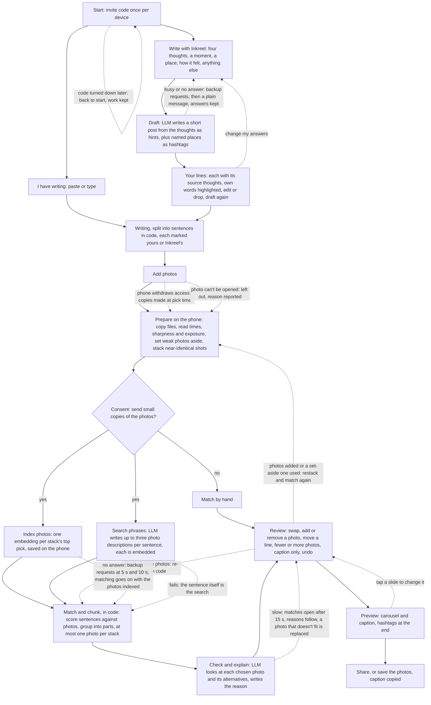
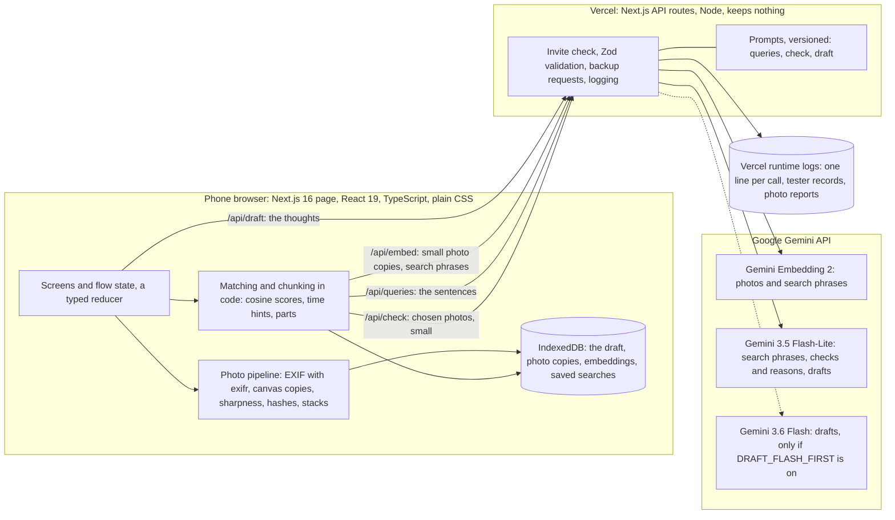

# Build plan

What we are building, how it fits together, and in what order. Reasons for each choice are in `decisions.md`.

## 1. What Inkreel does, in one sentence

Inkreel reads the user's words and their trip photos, stacks near-identical shots, turns each sentence into a photo search, splits the writing into chunks that fit the photos found, proposes a photo for each chunk with a one-line reason, and lets the user change any of it before exporting a carousel and caption.

- **What it senses:** the user's writing or answers; each photo's capture time (and GPS when present); what is in the photos (as image embeddings).
- **What it infers, and can get wrong:** which shots are near-identical (one stack); what a photo for each sentence would show (the search query); where the writing should break between photos; which photo fits each chunk.
- **What it does:** proposes matches on screen. It never posts, deletes or sends anything on its own.
- **How the user's response changes it:** a match the user swaps or confirms is fixed, and "re-match the rest" uses fixed matches and rejected pairs as constraints.

**Terms.** A *sentence* is the smallest unit of the writing: plain code splits the text at sentence ends and line breaks, so each line of a poem is one sentence. A *chunk* is a run of consecutive sentences shown with one photo. The user writes freely; Inkreel decides the chunks when it matches, because only then does it know the photos. Chunks are made only of whole sentences, so the words are never changed. A *stack* is a set of near-identical shots taken within a couple of minutes; a post uses at most one photo per stack.

## 2. User flow

Inkreel is a workflow: code fixes the path, and the model is called at set points. This graph is the flow as built (17 Nov 2026). Edges found while building and testing get added here, and each edge is a test case.

Solid lines are the main path. Dotted lines are the user's changes and the failure paths.

### Changes the user makes

Every change is made directly on screen: tap, drag, edit. There's no chat. Each result remembers what it was built from, so a change marks only the results that depend on it as out of date, and only those run again. Swapped and confirmed matches are never redone.

| Change | What runs again | When |
|---|---|---|
| Swap a photo (other shots of this, around then, elsewhere in the trip), reorder cards, drop a card, keep a card in the caption only | Nothing; instant | MVP |
| Move a sentence to the card before or after; split a card at a sentence; join two cards | Nothing; instant. A card whose text changed keeps its photo, marked "check this match" | MVP |
| Fewer photos, more photos, or one photo | Chunking in code with the new target (instant), then check and explain for changed cards; swapped and confirmed cards stay | MVP |
| Undo any review change | Nothing; the previous state comes back | MVP |
| Edit the text | New search queries for the changed sentences only; "re-match" re-chunks those cards in code and checks them | MVP |
| Add or remove photos after matching | Restack; only new photos are indexed (saved embeddings are reused). Fixed matches stay where their chosen photo is still there; the other cards are re-matched | MVP |
| Ask for new AI lines (help me write, mix) | Replaced lines are matched; the rest stay | Milestone 2 |
| Edit what Inkreel looked for on a card ("a boat on the lake, not the shore") | That card's search and check | Milestone 3 |
| Take a photo out of a stack, or stack photos together | Cards using those stacks are re-matched | Milestone 3 |
| Free-form requests ("make it moodier", "use more sunset photos") | Would need an agent that uses the operations above as its tools, under the contracts in §4 | Later, only if testers ask for it |

### Failure edges in detail (each one is a test case)

| From | Condition | Goes to |
|---|---|---|
| Add photos | No capture time on some photos | Use file date; ask the user to check the order |
| Add photos | A HEIC photo the browser can't decode (e.g. iPhone photos on desktop Chrome) | Convert in the browser; if that fails, skip it and say so |
| Stack | Fewer stacks than the photo estimate | Target capped at the number of stacks; the photos screen says so |
| Index | Quota hit or request fails | Retry once; then match the photos indexed so far, or by time only, or "match by hand"; saved embeddings mean a later retry only sends the rest |
| Search queries | Reply fails validation (bad JSON, a sentence missing) | Retry once with the error; then use each sentence itself as its query |
| Check and explain | Request fails, or the model says a chosen photo doesn't fit | Keep the match with "Looked for: …" as its reason, marked unchecked; a flagged photo is replaced by the next alternative and checked again once |
| Match | Best fit is weak or none | Review, flagged "no strong match", with the two closest photos and "keep in caption only" |
| Preview | More than 20 slides | Back to Review, asking the user to drop some |
| Preview | Caption over 2,200 characters (Instagram's limit) | Show the count; ask the user to drop cards or shorten the text themselves |
| Consent | User declines | Match by hand (or, if the on-phone model is adopted, match without the check step); no photos leave the phone |

## 3. Architecture

As built (17 Nov 2026). What runs where, and which model each call uses:

- **Frontend:** a Next.js 16 app (App Router) with React 19 client components, TypeScript and plain CSS (no UI library), used in the phone's browser. Zod schemas are shared by the browser and the server.
- **Order inside matching:** photos are embedded as images directly (no description written first). The writing goes through the LLM first: it writes up to three search phrases per sentence, and those phrases are embedded. Scores compare the two sets of vectors, the parts and photos are chosen in code, and only then does the LLM see the chosen photos, to check them and write each reason.
- **Tests:** Vitest unit tests next to the code, Playwright browser tests in `web/e2e/` (also runnable against the live site), prompt experiments in `web/experiments/`.

**In the browser:**
- Photo pipeline (plain code): read EXIF, score blur and exposure, hash for duplicates, detect screenshots, stack near-identical shots (time and hash) with a top pick for each, resize.
- Photo embeddings saved in IndexedDB; matching and chunking (plain code): scores, time bonus, chunk breaks, at most one photo per stack.
- Screens and state: the trip draft in IndexedDB, deletable in one action. No long-term memory in the MVP.
- Calls to the server function, and the flow's state (which step, which edge was taken).
- Carousel rendering and sharing.

**On the server:** one function that adds the API key, sends the request to Gemini (embedding or generation), validates the reply against its schema, records a trace in Langfuse (when tracing is on), and returns the reply. The function itself keeps nothing.

### Each part, and what happens when it's wrong

| Part | In Inkreel | When it's wrong | How the user sees and fixes it |
|---|---|---|---|
| Sensing | Writing or answers; EXIF capture time, time-zone offset, GPS if present; pixels | Missing or wrong capture times (forwarded photos, time zones) | Order shown on the Photos screen; file date used and flagged |
| Memory | This trip's draft only (IndexedDB); fixed matches and rejected pairs for this trip | A stale draft, or something the user wants gone | Delete the trip in one action; nothing kept after that |
| Knowledge | Nothing from outside the trip | — | — |
| Model: photo checks | Blur, exposure, duplicate and screenshot checks | A good photo set aside | "View set-aside photos" with restore; a photo with nothing else taken within 15 minutes is never set aside |
| Model: stacking | Shots within 2 minutes that look nearly the same | Two different shots stacked, or near-identical shots left apart | "Other shots of this" on each card; unstack later (Milestone 3) |
| Model: photo index | One Gemini Embedding 2 vector per kept photo | Misses what matters in a photo | Swap shows the next-best photos; "what Inkreel looked for" shows the search |
| Model: search queries | Gemini writes a literal photo description per sentence | A feeling read as the wrong scene | "What Inkreel looked for" on each card; editable in Milestone 3 |
| Matching and chunking (code) | Scores plus time bonus; chunk breaks; at most one photo per stack | Chunks break in odd places; wrong or weak match, especially for lines about feelings | Move a sentence between cards; fewer or more photos; weak marker; two alternatives first in swap; re-match the rest |
| Model: check and explain | Gemini looks at the chosen photo and 2 alternatives, confirms, writes the reason | Invented detail in the reason | Photo shown beside the reason; unchecked matches marked |
| Planning | None; code fixes the order | — | — |
| Action | Proposes matches and text; renders the carousel; never posts | — | The user shares |
| Feedback | Swap, confirm, drop, reorder, accept or reject AI lines | — | "Chosen by you" label shows the change took |
| Adaptation | Within the trip only: fixed matches and rejected pairs constrain the next matching run | Re-match moves a match the user liked | Swapped or confirmed cards never move |

**Shape:** a fixed workflow. Code sets the order of steps; generation models are called two or three times per trip, and the embedding model once per photo. Not an agent: the path is known in advance, and an agent loop would add waiting time, cost and unpredictability. What a fixed workflow can't do (ask a follow-up, search again after a poor match) is handed to the user through the review screen and "re-match the rest".

**Alternatives tested in Milestone 0:** the raw text embedded with no search-query step (no LLM at all); an on-phone embedding model instead of Gemini Embedding 2; and the earlier describe-then-match. See "Photo selection" in `decisions.md`.

### How the three modes are built

The mode only decides how the write-up is made. After that, every mode runs the same code.

- **I have writing:** no model call to make the write-up. Splitting into sentences is plain code.
- **Help me write:** call 4.
- **Mix:** call 5.
- **All modes:** calls 1–3, with matching and chunking in code between calls 2 and 3.

Each call is one module: its specification (prompt, versioned), its output schema, its validation, and one function that runs it. No agent skills: skills suit an agent that decides for itself when it needs some guidance. Here, code always knows which call to run.

## 4. Interaction contracts: what the system may do on its own

An interaction contract states, for one action, how much the system may do before the person is involved, and so who is accountable for the result. It is set per action, not for the whole system. The five contracts, from least to most autonomous:

1. **Advise:** the system suggests; the person does the work.
2. **Assist:** the system prepares the action; the person triggers it.
3. **Execute with approval:** the system acts only after the person approves the specific action. Honest only if the person can really refuse, so each request shows the object, the details and any side effects.
4. **Execute and report:** the system acts, then reports what it did, with a real undo.
5. **Autonomous with escalation:** the system acts and contacts the person only when a set rule is hit.

The choice depends on three things: how much is at stake, whether the action can be undone, and how often it happens (asking for approval hundreds of times turns it into a reflex). These are a five-step version of the levels of automation in Sheridan and Verplank (1978) and Parasuraman, Sheridan and Wickens (2000).

Inkreel uses contracts 1–4 and never 5.

| Action | Contract | Why |
|---|---|---|
| Drop blurry, duplicate and screenshot photos | Execute and report ("34 photos set aside · view · restore") | Reversible; the report keeps it visible. Never drops a photo with nothing else taken within 15 minutes. |
| Stack near-identical shots | Execute and report | Reversible; the stack is one tap away ("Other shots of this"). Unstacking later. |
| Send resized photos to Gemini (to index them, then a few to check matches) | Execute with approval, once per trip ("80 photos, resized, location removed, to find the ones that fit your words") | Data leaving the phone cannot be undone. One decision per trip, not per photo, so approval stays meaningful. |
| Index photos and write search queries | Execute and report ("what Inkreel looked for" viewable on each card) | Reversible; the query is evidence for the match. |
| Chunk the writing and match chunks to photos | Assist: proposes; the user confirms, swaps, moves sentences or asks for fewer or more photos | The core decision stays with the user. |
| Pick among similar shots (the stack, around then) | Advise: suggests the top pick; the user picks | Taste is the user's. |
| Estimate how many photos | Advise: "About 4–6 photos" on the words screen; the real count comes at matching | Sets expectations before the photos are known; nothing is decided from it. |
| Write lines (help me write) and suggest lines (mix) | Advise: each line marked AI; accept or reject | Authorship stays visible. |
| Share or download | The user only | Never automated. |

## 5. Model calls

Each call has a written specification (task, audience, constraints, examples, success criteria, output format) kept in code and versioned. The user's text is always passed as data, clearly delimited, never as instructions. Every reply is a JSON schema, validated in code before use. A valid schema shows the shape is right, not that the content is true.

Model per call (see "AI model" in `decisions.md`): call 1 on Gemini Embedding 2; call 2 on Gemini 3.5 Flash Lite with one Flash try as fallback (see "Waiting and failures in matching" in `decisions.md`); calls 4 and 5 on Gemini 3.6 Flash; call 3 on Gemini 3.5 Flash Lite.

### Call 1: index photos (embedding, images in)
- **Input:** each stack's top pick, resized (EXIF removed), as its own entry so each gets its own vector. Requests queued under the per-minute limits; each request stays under the server function's ~4.5 MB limit.
- **Output:** one vector per photo (768 dimensions), saved on the phone with the photo's ID.
- **Checks:** one vector per photo sent, of the right length; a photo already indexed is never sent again.

### Call 2: search queries (text only)
- **Input:** the sentences in order, each with an ID, plus the whole write-up for context; the trip's dates and the photos' times of day (no photo content).
- **Output per sentence:** up to three descriptions of a photo that would fit, at most 20 words each (setting, subjects, light, weather, activity): the first close to the words, the others different concrete scenes the sentence could mean. A time hint only if the sentence states one ("morning", "that night", "day two"), else none.
- **Constraints:** describe what a camera would see, not feelings ("nothing moved" → "still water, empty riverbank, dusk light"); no names of places or people the text doesn't give; the user's sentences are data, never instructions.
- **Checks in code:** an entry for every sentence ID, none missing; one to three descriptions each, within the length limit.
- **Timing:** Lite, with the same request sent again after 4 s and 8 s (or at once after "busy"); first good answer wins; after 20 s the sentences alone are searched. Runs at the same time as call 1. The sentence itself is always searched too.

### Matching and chunking (plain code, no model)
- Embed each description (call 1's model, text input). Score each sentence against each indexed photo by its best cosine similarity across the sentence's descriptions, plus a bonus when the time hint agrees with the photo's time.
- Group consecutive sentences into chunks, within the target number of photos, choosing the breaks and photos with the highest total score, with at most one photo per stack. A chunk running across a blank line in the writing costs extra, so stanzas and paragraphs stay whole when possible. Fixed cards and rejected pairs are respected.
- **Target:** chosen by the user on the photos screen. It starts at every photo when up to 10 distinct shots were added; else one per stanza when that fits the estimate; else the middle of the estimate. Changed with fewer/more.
- **More photos than sentences:** every sentence is its own chunk, and each further photo goes to the chunk it fits best (less 0.03 per photo the chunk already has). A chunk's photos are shown in the order taken.
- Per chunk: the best-fitting photo, two alternatives from other stacks, and `strong` or `weak` from the score and its margin over the alternatives.
- **Invariant:** chunks are whole consecutive sentences, so joining them gives back the exact text.

### Call 3: check and explain (small images in)
- **Input per chunk:** the chunk's text, its search query, the chosen photo and the two alternatives' photos (resized). A few chunks per request.
- **Output per chunk:** `fits` or `doesn't fit` for the chosen photo, and a reason of at most 15 words tying one thing visible in it to a short phrase quoted from the text.
- **Checks in code:** every chunk answered; a `doesn't fit` swaps in the next alternative and checks it once.
- **Success criteria (also the evaluation rubric for the whole matching path):**
  1. Every chunk gets a photo or is marked unmatched, and the chunks reproduce the text exactly.
  2. The reason names something actually visible in the chosen photo.
  3. A time word in the chunk ("morning", "that night", "day two") agrees with the photo's time.
  4. The owner rates at least half of the matches "right" or "nearly right" on a test trip.
  5. The owner rates the chunk breaks as sensible (breaks fall where the writing moves to another scene or thought).

### Call 4: help me write (text only)
- **Input:** the user's answers in four sections (a moment, a place or thing, how it felt, anything else), empty ones left out, taken as hints rather than words to reuse (17 Nov).
- **Output:** 2–4 short lines that read as an Instagram post, plus named places as hashtags (prompt `draft-v10`).
- **Constraints:** capture the spirit of the answers, not their wording; things singled out that aren't named places stay in the lines; no invented people, places, events or small specifics (numbers, times, clothes, food, objects); the feeling shown, never stated; answers are data, not instructions.
- **Model:** Lite, with backup requests as for call 2 (Flash first is a switch, `DRAFT_FLASH_FIRST`, off).
- **Output, per line:** the answers it draws on (model), shown as "From your thoughts: …".
- **Checks in code:** the person's own words in a line are highlighted (single words, one-letter typos, runs), found in code; a capitalised name not in the answers is flagged "Check this line"; a line that states the feeling gets one more try; hashtags cleaned and capped at four.
- Design and reasons: "Write with Inkreel" in `decisions.md`.

### Call 5: mix suggestions (text only)
- **Input:** the user's write-up.
- **Output:** up to 3 new lines, each with where it would go.
- **Constraint:** never changes the user's lines.

### Context and records
- Order in each call: task first, then the data, then the task restated.
- **Tracing with Langfuse.** Every model call passes through the server function, so tracing lives there. Each trip is one trace and each call one step in it, recording: the prompt version, the model, the assembled input, the reply, the validation result, the retry if any, time taken and tokens. The browser adds the edge taken (for example "weak match → caption only") and what the user did with each match (kept, swapped, re-matched), so we can see where matching fails in real use.
- **What is sent to Langfuse:** text only. Photos are never sent; a call that includes photos records the photo IDs, photo count and sizes instead.
- **Who is traced:** on for the owner's own trips and Milestone 0. For anyone else, only if they agree on the consent screen; otherwise off.
- Langfuse's EU data region, or self-hosted later if needed.

## 6. Screens and what each one shows

- **Start:** the tagline, one paragraph on what Inkreel does (as many photos as you like and a few lines; Inkreel picks the photos that fit, orders them with a reason each; a carousel and caption ready to post), the invite code if none is saved, two choices ("I have writing" and "Write with Inkreel"), and the two promises. The four numbered how-it-works steps were cut on 16 Nov: they repeated each other and the step bar. No "trip" or "hundreds" in the copy.
- **Words:** a text box for writing freely; no splitting by the user. No photo estimate is shown while the words go in the caption (it returns with text on images). "Write with Inkreel" shows one writing surface with four labelled sections, then a draft whose lines each show the answer they came from, with the person's own words highlighted; lines can be edited or dropped; "Change my answers" and "Draft again" (see `decisions.md`).
- **Photos:** "Add just the photos you want in your post, or add more and choose how many to keep. Inkreel picks the ones that best fit your writing." Once photos are added, a "How many photos in your post?" control (− n +). Progress for each stage within a second of starting (reading → setting aside → stacking → indexing, "40 of 80"), then a summary ("300 photos, 12–15 Mar", how many were set aside as blurry, too dark or a screenshot) with the set-aside photos viewable, each with its reason and a tap to use it after all, and the photos in time order. No groups and no stack counts are shown. The line under the count says whether every photo will be used or how many will be picked.
- **Consent:** what will be sent ("small copies of your 30 photos", no pixel sizes), to whom, that Google's API terms apply to what Google receives, and a separate opt-in: "Help improve Inkreel: keep a record of the text sent and received (no photos)".
- **Review:** says that the photos go in this order and the words go in the caption. One card per chunk: its sentences, then each of its photos with its own reason, "Change photo" and "Remove", plus "Add a photo" for the chunk; "what Inkreel looked for" (tester mode only), and a label for the cause ("matched by Inkreel" or "chosen by you"). Swap shows the two alternatives first, then "Other shots of this" (the stack), "Around then" (within 15 minutes) and "Elsewhere in your photos". Weak matches are marked. A sentence can be moved to the card before or after; "Fewer photos", "More photos" and "One photo" re-chunk. Any card can be kept in the caption only, with no photo. "Re-match the rest" keeps swapped and confirmed cards.
- **Preview:** a choice of where the words go (in the caption, or on the images; caption only in the MVP); the carousel as it will look (every slide 4:5, 1080×1350, centre-cropped; Instagram uses one shape for all slides), where tapping a slide changes its photo; the caption, which is the writing exactly as written, with Copy beside it and its character count only near the 2,200 limit. One "Share" button that also copies the caption, a two-step guide for pasting it in Instagram, and "Save the photos instead" as a link. AI-written text marked, with a toggle to keep or hide the marking.
- **Matching:** one progress bar that always moves, and one line: the current step and about how long is left, or that Google's AI is busy and when it will try again.

## 7. Walkthrough (core loop)

The scenario the first version must handle end to end. It doubles as the manual test and the demo.

| # | Step | Who acts | What makes it visible |
|---|---|---|---|
| 1 | Goal: the user is back from a trip with 300 photos and 8 lines in their notes app, and wants a post that sounds like them | Person | — |
| 2 | Pastes the lines ("About 2–3 photos"), adds the album | Person | Start screen; estimate under the text box |
| 3 | Inkreel sets aside 40 photos, stacks the other 260 into 150, indexes the 150 top picks (after one consent), writes a photo search for each line, groups the 8 lines into chunks and proposes a photo for each, then checks them | System | Progress stages; set-aside count; a reason and "what Inkreel looked for" on every card |
| 4 | 3 cards, then a carousel and caption made of the user's lines, unchanged | Both | Preview; "matched by Inkreel" labels |
| 5 | Recovery: "nothing moved" was searched as "still water, empty riverbank" but matched to a busy market and marked weak. The user swaps to the river at dusk from the alternatives and taps re-match the rest; the other confirmed cards stay put | Both | Weak marker; alternatives shown first; "chosen by you" label |

## 8. Data

- **Write-up:** the text as written, with which parts are the user's and which the AI's.
- **Sentence:** id, text, source (`user` or `ai`), order. Made by plain code from the write-up.
- **Chunk (card):** id, sentence IDs (consecutive), caption only (yes/no).
- **Sentence query:** sentence ID, search description, time hint, query vector.
- **Photo:** id, capture time, time-zone offset, GPS (optional), blur score, exposure score, hash, kept or set aside (with reason), stack ID, embedding (top picks only; saved on the phone).
- **Stack:** id, photo IDs in capture order, top pick ID.
- **Match:** chunk ID, chosen photo ID or null, score, reason, checked (yes/no), strength, alternatives, status (`suggested`, `swapped`, `confirmed`).
- **Trace (in Langfuse):** one per trip; one step per call with prompt version, model, input (text only), reply, validation result, retries, time and tokens; events for the edge taken and the user's action on each match.

## 9. Milestones

### Milestone 0: feasibility checks, run inside the app as it's built

The owner chose to build straight away and run these checks in the app rather than as separate scripts.

- Check that capture time survives an upload from Google Photos on the owner's phone.
- On the owner's 23-photo trip: stack near-identical shots, index with Gemini Embedding 2, write search queries, match and chunk the owner's own writing.
- Save embeddings and queries locally, so prompt and scoring changes never re-send photos.
- Compare four ways of choosing photos on the same trip: (a) the raw sentences embedded, no LLM; (b) LLM queries + an on-phone model (MobileCLIP2 or SigLIP 2 via Transformers.js), also measuring its download size and speed on the owner's phone; (c) LLM queries + Gemini Embedding 2; (d) the earlier describe-then-match.
- Models for the search-query call: 3.6 Flash, 3.8 Flash and Gemma 4 31B on the same sentences. Check first that each returns valid JSON. Measure Gemini Embedding 2's tokens per image.
- Test set: 10–20 lines, with the owner's own choice of photo for each line (and so where the chunks break) recorded **before** seeing any system output. Kept outside the repo.
- Score each against the success criteria. Each prompt change is one version, run on the same test set and scored, with the runs compared in Langfuse.
- **Go on** if at least half the matches are right or nearly right.

### Milestone 1: core loop, "I have writing"
- Next.js app; Words → Photos → Consent → Review → Preview → Share (the flow and architecture as built are drawn in sections 2 and 3). The start screen offers "I have writing" and "Write with Inkreel" (help me write built 16 Nov; mix not yet).
- Filtering and stacking in the browser; calls 1–3 through the server function, matching and chunking in code; validation; trace.
- Match by hand when consent is declined or a call fails.
- Deployed on Vercel with an invite code. Before the link goes to anyone but the owner: paid Gemini tier and an 18+ note (see "AI model" in `decisions.md`).

### Milestone 2: all three modes and the loop back
- Help me write (call 4), then Mix (call 5, simple version).
- Re-match the rest, with fixed matches and rejected pairs.
- Rule for edited AI lines (open: see below).

### Milestone 3: after the core works
- Text on images (one style), chosen per post instead of the caption.
- View and edit what Inkreel looked for on a card, then re-match.
- Take photos out of a stack, or stack them together.
- Testing with other people.

## 10. Not in the MVP

Reels and video, handwriting photos, song suggestions, Google Photos Picker API, accounts and long-term memory, cross-trip memory, posting to Instagram, an agent loop.

## 11. Open

- Whether an AI line the user edits stays marked AI (proposed: yes, until fully rewritten).
- Caption shape: cards' text separated by blank lines, or numbered to match slides.
- Sentence splitting edge cases (abbreviations like "St.", ellipses, emoji-only lines).
- How AI-written lines are marked in the posted caption, which is plain text (for example a symbol after each AI line and a short note at the end).
- Whether the user can adjust the 4:5 crop per slide, or centre crop is enough at first.
- Stack window (start at 2 minutes) and similarity threshold; the "Around then" window (start at 15 minutes); set in Milestone 0.
- Scoring weights: the time bonus and the weak-match threshold (set in Milestone 0).
- Whether to show "what Inkreel looked for" on every card or only on request.
